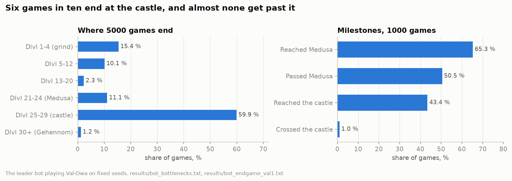
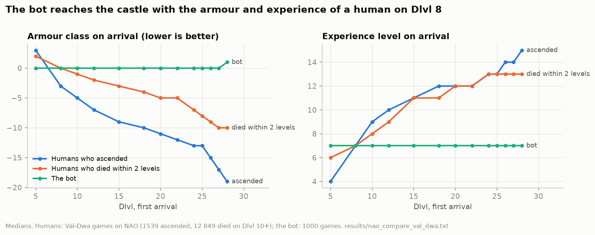
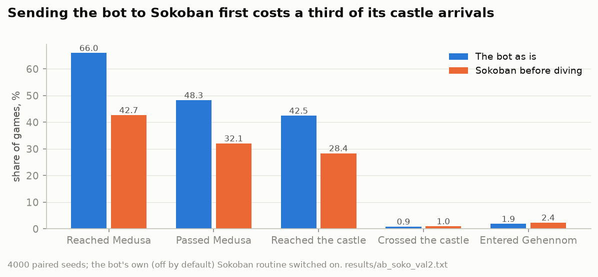

# The bot and where it dies

The bot is `pf_base` from [daglar-dragomirov/nethacker](https://github.com/daglar-dragomirov/nethacker), built on
AutoAscend. It plays a lawful female dwarven Valkyrie in the NetHackers arena, which derives every game from a seed,
so a game can be replayed and an A/B test can be run on the same seeds. Two hooks are added to the bot: one writes a
trace of every step (screen, status, the bot's strategy stack, nearby monsters, inventory changes), the other lets an
experiment replace one decision at a chosen step (see [branches](branches.md)).

Progress is measured with the arena's BALROG table: a number from 0 to 1 for the deepest level reached, with extra
credit for Gehennom. The bot's mean over 1000 games is 0.41.

## How it plays

`bot_profile.py` over 1000 games (`results/bot_profile_val1.txt`):

1. **Grind.** About 12 000 turns on Dlvl 1 to 3. The Valkyrie reaches experience level 5 on Dlvl 1 (the level needed
   to dip for Excalibur) and level 7 on Dlvl 3. Excalibur is obtained in 26 to 31 % of games.
2. **Dive.** Then it digs straight down: from Dlvl 4 to Dlvl 25 and below within a few hundred turns. 67 % of games
   have a digging tool by Dlvl 4, all of them by Dlvl 18.
3. **Arrive.** On any level from 4 to 29 the hero arrives the same: experience level 7, AC 0, 78 hit points, around
   turn 12 700. Reflection, identified magic resistance, dragon scale mail and speed boots: 0 % of games. Levitation:
   2 %.

Diving at a low level is deliberate. The hardest monster NetHack generates depends on the average of the dungeon depth
and the hero's experience level, so a level-7 hero meets easier monsters deep down than a level-10 one. The authors
note in their code that their level-10 dives died on Dlvl 10 to 12 to air elementals, Elvenkings and flesh golems.

## Where its games end

| Where the game ends | Games | Main causes |
|---|---|---|
| Dlvl 1-4 (the grind) | 15.4 % | rothe, hill orcs, giant ants, starvation |
| Dlvl 5-12 | 10.1 % | soldier and fire ants, elves, leocrotta |
| Dlvl 13-20 | 2.3 % | Elvenking, elf-lords |
| Dlvl 21-24 (Medusa) | 11.1 % | **drowning while digging** (36 %), ravens (23 %) |
| Dlvl 25-29 (the castle) | **59.9 %** | **minotaurs** (23 %), sharks, drowning, xorns, starvation |
| Gehennom | 1.2 % | xorns, minotaurs |

(`bot_bottlenecks.py`, 5000 games, `results/bot_bottlenecks.txt`.) Weighting each band by how much progress one more
level would be worth, the castle carries more than everything else combined.

From Medusa down (`bot_endgame.py`, `results/bot_endgame_val1.txt`): 65 % of games reach the Medusa level, 51 % get
past it, 43 % reach the castle and **1 %** cross it into the Valley of the Dead. Another 1.6 % of games end up in
Gehennom by a lottery: a scroll of teleportation read with teleport control, asking for level 50, which NetHack turns
into "you arrive at the Valley" for anyone who has not been there. 13 of those 16 games did it from Dlvl 1 to 4.

**Minotaurs** (`minotaur_encounters.py`, `results/minotaur.txt`). A minotaur comes within 7 squares in 24 % of games,
almost always in the mazes and on the castle level. 69 % of those heroes are dead within 50 turns, 58 % killed by the
minotaur itself. The bot already has a dedicated defence (pray, dig down with a wand, use a known wand, go upstairs,
teleport, genocide, scare monster, then try unknown wands and scrolls); the heroes it loses are the ones with nothing
left to try.

## Bot vs humans

To see what the bot lacks, the same measurements were taken from human games: 1539 ascended dwarven Valkyries and
12 849 that died on Dlvl 10 or deeper, from the NAO public server (`nao_corridor.py`, terminal recordings decoded with
NLE's converter, `results/nao_compare_val_dwa.txt`).

- **Humans grow on the way down, not before it.** An ascending player reaches experience level 10 on Dlvl 7 and level
  14 on Dlvl 20. The bot is at 7 everywhere.
- **Experience does not separate winners from losers; armour does.** Comparing humans who ascended with humans who
  died within two levels of the same point, experience levels are within one of each other on every level. Armour class
  differs by 4 to 9 points, and the ascending group carries reflection 2 to 4 times as often, magic resistance 2 to 3
  times, levitation 1.5 to 2 times (Dlvl 10 to 20).
- **Those who died came down faster.** They reached Dlvl 10 at a median turn of 4900, the ascending players at 6950.
- By Dlvl 25, ascending players carry Excalibur (92 %), a source of reflection (81 %), levitation (72 %), dragon scale
  mail (61 %), identified magic resistance (51 %), speed boots (42 %). The bot: Excalibur 30 %, the rest 0.

The mechanics agree. A monster hits when `10 + AC + its level > d20`, and with negative AC each hit loses another
`rnd(|AC|)` damage; reflection and magic resistance stop the instant deaths of the deep levels. The bot's own authors
reached the same conclusion from their experiments (in `jf_config.py`): grinding to a higher experience level before
diving, or exploring the middle levels, made the bot weaker (progress −0.07), and only better AC helped it past Medusa.

## Making the bot stronger: what was measured

All tests are paired: the same seeds with and without the change.

**`ARMOR_UP`** (put on the best armour from the pack every 25 quiet turns, read known enchant armor). 1000 pairs:
progress +0.004 (t = 1.6, noise). AC improved in only 13 to 14 % of games: there is little armour in the pack to put
on. AC of −5 to −13 needs a source of armour, which means exploring the middle levels, the very thing the authors
measured as harmful at experience level 7.

**`SOKOBAN_TRIP`**, the authors' own routine (off by default, never measured by them): before diving, go up to
Sokoban and solve it. 1000 + 4000 pairs:

Progress drops from 0.41 to 0.31, castle arrivals from 42.5 % to 28.4 %. A closer look (`soko_study.py`,
`results/soko_study.txt`):

- 43.6 % of games die **on the way** to Sokoban, on Dlvl 2 to 8 at experience level 7 or 8 (soldier ants, rothes, hill
  orcs, fire). Only a quarter of games get there at all.
- Inside, the bot spends a median of 2100 turns and goes hungry in two thirds of games.
- The 309 games that finished it do no better afterwards than their twins without the detour (castle 51 % vs 53 %):
  the bot does not turn the loot into progress (levitation is used after Sokoban in 19 % of those games).

That is a verdict on this routine, not on Sokoban: among human Valkyries, 89.5 % of those who ascended had the Sokoban
prize. The order of fixes would be: use what Sokoban gives first, then find a safer way there.

**Priest protection** (donating 400 × level gold to a temple priest for −2 to −4 AC) is not in the bot. Not measured
yet.

## Why this bot

AutoAscend itself, as recorded in the NLD-AA dataset (109 545 games), has a median deepest level of 2 and never reaches
Dlvl 25. Its dwarven Valkyries that reach Dlvl 10 arrive there around turn 36 000 with AC −3. `pf_base` reaches
Dlvl 25 in 60 % of games, so it stays the base; what it lacks is building the hero up on the way down.

## Choosing the character

`stats/roles_table.py` over 2.28 million games from NAO and Hardfought (`stats/roles_table.txt`). The raw ascension
rate is misleading: Valkyries are popular with beginners and Cavemen with veterans. Split by the player's earlier
ascensions (0 / 1-4 / 5-19 / 20+), the dwarven Valkyrie ascends most often in three of the four groups: 0.60, 5.79,
9.87 and 27.95 %. More in [`stats/README.md`](../stats/README.md).
