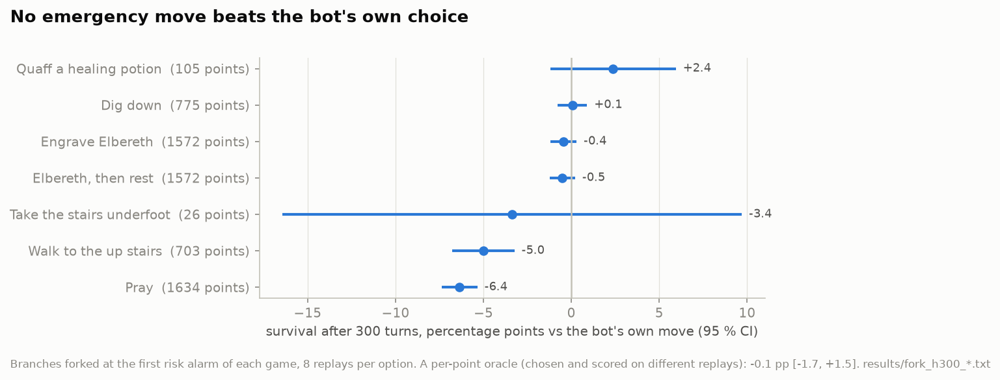

# Emergency moves

The risk model sees most deaths coming. The obvious next step: when it raises the alarm, do something else. NetHack
has a handful of emergency moves (pray, engrave Elbereth, quaff a healing potion, take the stairs, dig down), and the
bot already uses all of them by its own rules. The question is whether, at the moment of the alarm, a different choice
from that list would keep the hero alive more often. To answer it, every option has to be played out from the same
moment, several times.

## Replaying a game

The arena derives every game from a seed, and the bot is deterministic given its own seed. In practice the first
replays matched the original in only 34 to 38 games of 40. The causes:

- **The real clock.** NetHack reads the wall-clock time: at night and at midnight some things change (regeneration,
  werecreatures, gremlins). The container ran in UTC, so a replay at a different hour
  diverged. Freezing the clock with `libfaketime` (an image based on the arena's, `trace/image/Dockerfile.frozen`)
  fixed it.
- **The harness.** A remaining off-by-one turn in multi-turn actions turned out to be an artefact of a hand-written
  replay script with different limits. Running the bot itself twice (`collect.py`) gave 10 games out of 10 identical
  action for action, with each other and with the original run.

A branch is then a fresh game from the same seed with one decision replaced: `laya_branch.py`, a strategy layered on
top of the bot's own, waits for the chosen step (checked against the status line of the recorded game) and runs the
option with the bot's own code (`agent.pray()`, `agent.engrave(...)`). The prefix matches the original up to that
step, and after it the outcomes differ.

## Forking instead of replaying

The first branch runs were wasteful: the branch points were 11 to 15 thousand turns into the game, the branches 300
turns long, so 97.8 % of the work was replaying the prefix, once per option. And each (point, option) gave one yes/no
outcome, which is too noisy for effects of 1 to 2 percentage points.

`forkrun.py` runs NetHack and the bot in one process and calls `fork()` at each branch point:

- the parent keeps playing the original game;
- a frozen "template" child waits; for every (option, replay) it forks again when a CPU slot is free;
- each child reseeds NetHack's random generator (core and display; the level generator is kept, so the levels stay
  the same and only the fights differ), runs its option and plays 300 turns.

The hard part was NetHack's own files: it keeps level files in a directory whose path is a global C string
(`settings.hackdir` in `libnethack.so`). Each child copies the directory and rewrites that string through `ctypes`;
files open for reading are reopened, because after `fork()` they share an offset with the parent. The bot's agent runs
in its own thread, and only the calling thread survives `fork()`, so the fork happens between the agent's actions.

Checks: the parents replay the original games step for step; replay 0 of an option equals the old replay-from-scratch
branch; runs are deterministic and can be merged (the same (point, option, replay) gives the same result).

967 games, 1682 branch points (the first risk alarm of each game, and up to two later ones at least 300 turns apart),
7 options, 8 replays each: 64 166 outcomes.

## Results

(`build_fork.py`, `results/fork_h300_stats.txt`.)

- **Praying is harmful**: −6.4 points; worse than the bot's move at 38 % of points, better at 17 %.
- **Walking to the up stairs is harmful**: −5.0.
- **Elbereth, with or without resting on it, digging down, the stairs underfoot**: no different from what the bot does.
- **A healing potion** looks good (+2.4) but is available at only 105 points, and the interval includes zero.
- The answers barely depend on the horizon (100, 200 or 300 turns).

Could a model pick the right option at each point, even if no option wins on average? The best a model could do is
bounded by an oracle that picks the best option at every point. Choosing on even replays and scoring on odd ones, on
297 test points the oracle gains **−0.1 points** [−1.7, +1.5]. The best option at a point cannot be told apart from
noise, so there is nothing for a model to learn. It was tried anyway: laya as a yes/no model per option
and as a choice model, logistic regression and gradient boosting, all within ±1 point of the bot's own move
(`results/fork_h300_eval_h300.txt`).

Two cheaper alternatives were checked on the same data and rejected: a value model that cuts rollouts short (a perfect
one would save at most 1.3× at a 200-turn cut), and adaptive allocation of replays per point (+0.4 points with 4
replays, no better than uniform).

## What it means

By the time the danger is visible, none of the moves the bot knows changes the outcome. What would change it is what
the hero has by then: armour, reflection, an escape item, and the bot arrives without them (see [the bot](bot.md)).
As a trigger for an emergency move the alarm is of no use; on the screensaver it stays as a number. The work moved to
the question of what humans do differently long before the danger: [human games](human-data.md).
