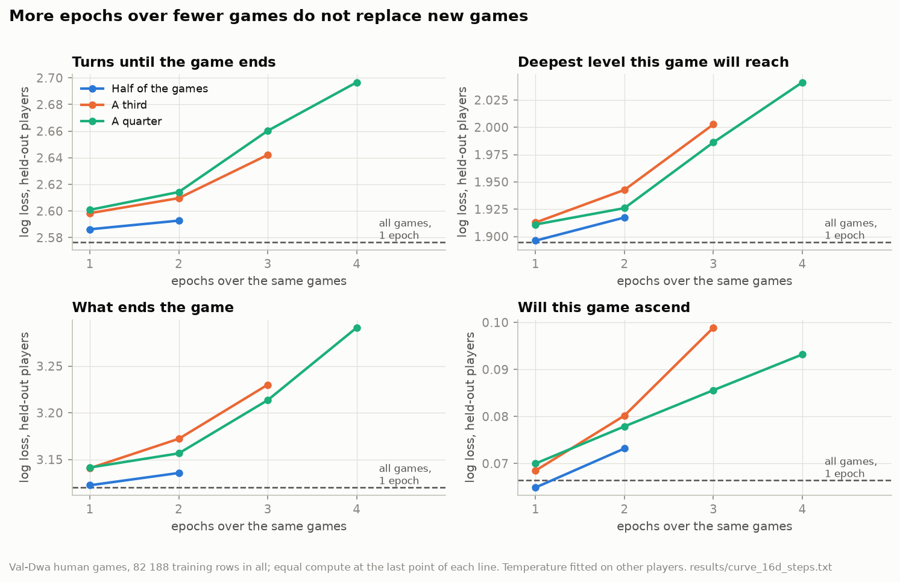
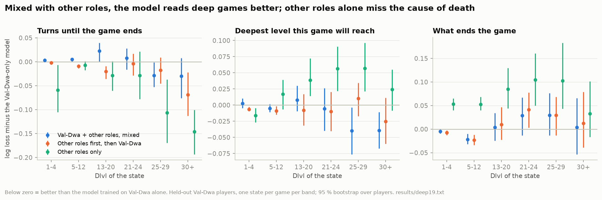

# How much data, and which

Some 65 000 human dwarven Valkyrie games are available for training, and about seventeen times as many games of
other roles. Three
questions follow: is that enough, should the same games be seen more than once, and do other roles help or get in the
way? All models here use the same recipe (laya, 20 layers, one epoch unless stated, packed batches of 16) and are
scored on players never seen in training.

## How to measure

Two things learned along the way shape every number below.

**Score by player, not by row.** The states of one game share its outcome, and a player's games share the player's
strength. Intervals are a bootstrap over players, and a game contributes about one independent observation however
many of its states are in the test (the design effect: with a correlation near 1 inside a game, the effective sample
size is the number of games).

**Score where it matters.** An average over all held-out states is dominated by the first levels, because every game
passes through Dlvl 1 to 4 and few reach Dlvl 25. The bot, on the other hand, dies at the castle in 60 % of its games.
So the final comparison takes one state per game per depth band (1-4, 5-12, 13-20, 21-24, 25-29, 30+) from all
held-out players and reports each band separately: 368, 298 and 168 held-out games reach the three deepest bands
(`deep_counts.py`, `results/deep_counts.txt`).

The log loss is reported after a temperature is fitted on the other half of the players, so differences in
calibration do not hide differences in what the model knows.

## More games

Training on a quarter, a third, a half and all of the games (`subset_games.py`, `curve_eval.py`,
`results/curve_16d.txt`, 82 188 rows in all):

| Question | 1/4 | 1/3 | 1/2 | all | half minus all |
|---|---|---|---|---|---|
| Turns until the end | 2.601 | 2.598 | 2.586 | 2.577 | +0.010 [0.005, 0.015] |
| How deep | 1.911 | 1.913 | 1.896 | 1.895 | +0.002 (noise) |
| What ends the game | 3.141 | 3.141 | 3.122 | 3.120 | +0.002 (noise) |
| Ascends | 0.0700 | 0.0685 | 0.0649 | 0.0664 | −0.0015 (noise) |

The turns-left question still improves with data, about 0.01 per doubling. The others stop improving between half and
all. Two caveats: two different random quarters differ by as much as 0.013 on depth and 0.018 on the cause of death,
and a second training seed moves the ascension question by 0.004, more than the half-to-all difference. Single
training runs are noisy at this level.

## The same games again

If new games stop helping, maybe more passes over the same games would. They do not:

(`finetune_fast.py --save-epochs`, `results/curve_16d_steps.txt`.) Every extra epoch over the same games makes every
question worse, and the fitted temperature grows (1.2 after two epochs, 3.2 after four on a quarter): the model starts
to memorise the training games. Half the games for two epochs, the same compute as all games once, is worse than all
games once. A checkpoint taken after the first epoch of a multi-epoch run is also worse than a one-epoch run (its
learning rate has not decayed yet at that point).

An earlier version of the human data had about eight states per game. A model trained on it, after one epoch, scored
a log loss of 1.45 on new players and 0.75 on its own training games: the same effect.

**Capping games per player** (at most 20 games from any one player, the same number of rows): no consistent effect.
Better than a random sample of the same size at one share, worse at another, by about as much as two random samples
differ (`results/curve_16d_cap.txt`).

## Other roles

Four designs, scored on the same held-out Valkyrie players:

- **Val-Dwa** alone (87 132 rows);
- **mixed**: Val-Dwa plus twice as many rows of other roles, shuffled together, one epoch;
- **staged**: other roles first, then Val-Dwa, the same compute as mixed;
- **other roles only** (174 444 rows, no Valkyries).

Over all bands (`results/deep19.txt`, log loss minus the Val-Dwa-only model, with 95 % intervals):

| Question | Mixed | Staged | Other roles only |
|---|---|---|---|
| Turns until the end | +0.004 (noise) | **−0.007** | **−0.041** |
| How deep | −0.002 (noise) | **−0.007** | +0.003 (noise) |
| What ends the game | **−0.008** | **−0.009** | **+0.058** (worse) |
| Ascends | noise | noise | noise |

By band:

- **Deep levels.** Mixed is better on turns-left at Dlvl 25-29 (−0.029) and on depth at Dlvl 25 and below (−0.040);
  other roles alone are much better on turns-left at Dlvl 25 and below (−0.11 and −0.15). Games of other roles that
  reach these levels are 11 to 15 times more numerous than Valkyrie ones.
- **The cause of death needs Valkyrie games.** A model trained only on other roles is worse on it at almost every
  depth (+0.05 to +0.10): different roles die to different things.
- **Mixing has a cost in the middle.** Mixed is slightly worse on turns-left at Dlvl 5-20 (+0.005, +0.023).
- **Staged and mixed are not distinguishable** on the original test (`results/mix17_staged_vs_mix.txt`: every
  difference within ±0.007 and not significant).

What is not answered yet: the right proportion. The mixed model used one arbitrary point (a third Valkyrie games, each
row once). Work on mixing a scarce target domain into pretraining (2605.12715, 2605.13225) finds the best results when
the target is repeated many times inside a larger mix, which the "repeats hurt" result above, measured without a mix,
does not rule out.
