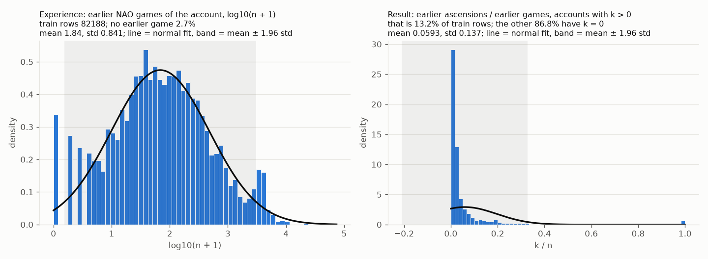

# Human games

The bot is a lower bound. The reference for what good play looks like is human play, and there is a lot of it:
NLD-NAO, part of the NetHack Learning Dataset, holds terminal recordings (ttyrec) of games on the alt.org public server
together with the server's game log (xlogfile): 227 GB of ttyrec and millions of games. A recording is only a stream of
terminal output: no keypresses, no game state, just what the player saw. Everything below is about turning that into
clean, dated snapshots of a game.

## What is extracted

`nao_corridor.py states` replays each recording through NLE's terminal emulator and keeps a snapshot of the game:

- on every first arrival at a dungeon level, and periodically in between;
- the screen (map, status lines, the message line), the inventory as last shown, the hit points 10 and 30 turns earlier,
  the last six messages, the colours of the monsters on screen;
- with `--events`, a log of every message and every change of level, AC, experience level or maximum hit points,
  which is where the player's actions can be read back ("What do you want to drink? [fgh or ?*]" and what followed).

Each game's outcome comes from the xlogfile: the deepest level, the turn count, the cause of death, ascension.

Sets used here: 58 885 dwarven Valkyrie games that reached Dlvl 4 (695 956 snapshots), 15 001 that did not, and
1.1 million games of the other roles.

## Pitfalls

Most of the work was finding what went wrong. Each item below was found by reading snapshots side by side with the
raw screen (`review_raw.py`) and counted over the whole set (`data_checks.py`, `junk_scan.py`).

**The cursor was read the wrong way round.** NLE's converter reports the cursor as (row, column); the code read
(column, row). Snapshots are only taken when the cursor is on the hero (the map is complete), so the extractor only
fired when the hero stood where row equalled column. On 2000 test games, fixing it raised the number of snapshots
from 13 531 to 24 624, and every human dataset built before that had snapshots skewed in time.

**The inventory was an accumulation of messages.** The first version collected inventory lines from everything on
screen. In a fifth to a quarter of snapshots an item line had a game message glued in; 29 % had two items merged into
one line, 4 % had items cut short.
Now the inventory comes from the inventory menu only, read by its column of class headers, across all pages, accepted
only when the game returns to the map. Menus from questions ("What do you want to use or apply?"), pick-up lists,
containers and shop bills are excluded on every page.

**The terminal was too small.** Some players' menus start at column 137, some run below row 23. The emulator now
uses a 256 × 64 terminal; a menu that touches the last row or column is discarded.

**One account, two games.** Recordings of consecutive games of one player can share a file: the first file of a game
is often entirely the previous game. A Valkyrie got a Wizard's inventory that way. Only frames whose timestamps fall
between the game's start and end in the xlogfile are used. A check of the rank title in the status line against the
game's role (`rank_check.py`) still finds a few players who ran two games at once; those games are dropped whole.

**Half-drawn status lines.** A frame caught mid-redraw shows "T:6" for turn 6603, or no turn at all. The status line
is read only when the cursor is off it, and a turn that is a prefix of the previous one is treated as the previous
one. A first, simpler rule ("the turn never decreases") was worse: a single misread turn of 5 681 116 stuck for the
rest of a game.

**Interface text in the message line.** NetHack 3.6 describes whatever the cursor points at ("tame housecat called
…", "floor of a room"); prompts, counts, "Pick an object", echoes of typed names. Messages are taken only with
the cursor on the hero or in the message line, and interface lines are filtered (1.1 % of messages before the fix,
0.04 % after).

**Players' own symbol sets.** Some players draw corridors with `|` or closed doors with `7`, or use UTF-8 box
characters that shift every column. Doors drawn as brown `7` are recognisable and translated; the other games are
dropped.

**Smaller ones.** The last status word cut at column 80 ("Satiated Burdene") is completed when the prefix is
unambiguous; the alignment comes from the status line, not from the xlogfile (which records the final one); the
player's name is replaced by "player"; gold in the inventory is dropped (it goes stale; the status line has it).

## Bots among the humans

The busiest "players" were not people. Pace in the recordings (`ttyrec_pace.py`: pauses between frames over 15
recordings per account) separates them: people have a 99th-percentile pause of 2 to 5 seconds and some pauses longer
than 5 seconds; 25 accounts never pause, play around the clock, and account for 2393 training games (5.1 %), some
of them with hundreds of dwarven Valkyrie games each. Another 19 accounts named after TAEB, a bot framework, play at a
human pace but never ascend and play around the clock (about 2370 games, 5 %). Together, about **10 % of the training
games** were bots. They are excluded by account (`bot_list.py`; the list itself is not published). A handful of
accounts with "bot" in the name play at a human pace and are people.

## Games that ended early

The first human datasets kept only games that reached Dlvl 4. The threshold had no measured reason, and it removed
22 % of dwarven Valkyrie games, almost all early deaths (`maxlvl_cut.py`, `results/maxlvl_cut.txt`). A model trained
without them underestimates the risk at the start of a game. They are now extracted (`make_early.py`) and included.

## Who plays well

The player's record is a strong signal. From the server's game log, each game gets the player's history before it:
games played and ascensions (`add_skill.py`, `skill_dist.py`). Among training games, a player with no earlier games
ascends 4.4 % of the time; a player with earlier games but no ascensions, 1.5 % after up to 9 games and 0.08 % after a
thousand; among players with earlier ascensions, the top fifth by ascension rate ascend 42 % of the time. This history
is given to the model inside the question ("A human (experience 3/5, result 4/5) plays.").

## Message logs

The event logs (`events_survey.py`, `results/events_survey_dwa.txt`) show what happens before a death compared with a
random stretch of the same game: prayers 8.3 times more often, zapping wands 5.1×, Elbereth 3.5×, quaffing 2.8×;
messages of petrification, illness, deadly poison, the watch of Minetown, mind flayers, "your life force is running
out". Many of these threats are not visible on the screen at all, which is an argument for giving the model recent
messages.

The same logs show how the hero is built up (`prep_survey.py`, `results/prep_survey_dwa.txt`): fire, sleep and poison
resistance and Excalibur come on Dlvl 1 to 12; dragon scale mail, magic resistance and reflection in about half of the
cases on Dlvl 5 to 12; AC improves in 99 % of games that ascend or go deep. Events read from messages are a lower
bound: the first of two messages separated by `--More--` is often lost.
