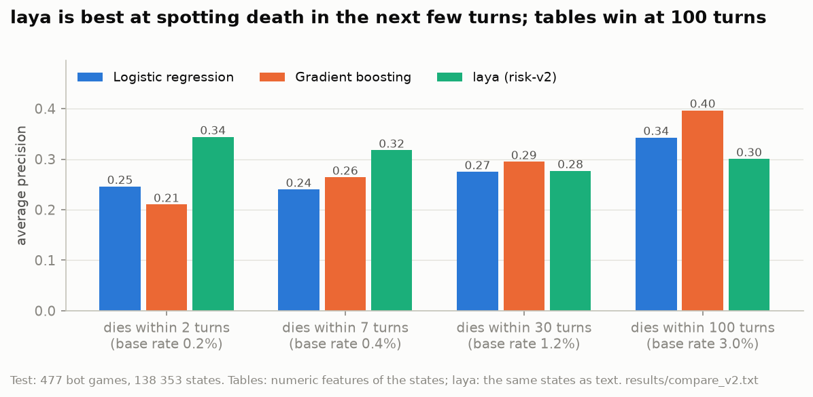
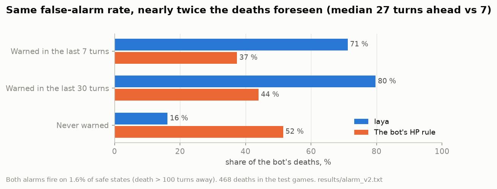
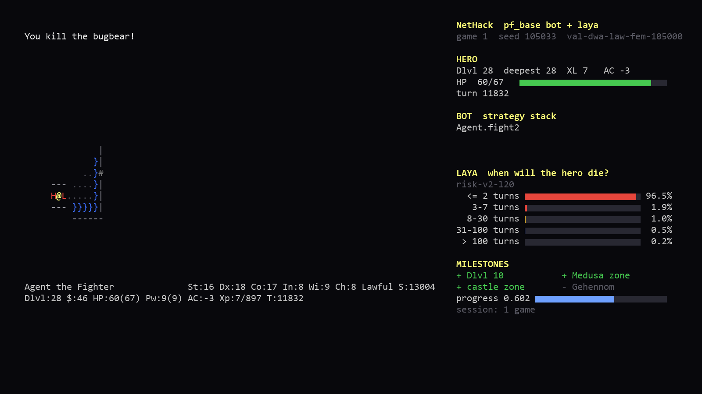

# Predicting death

The first job given to the model: look at the bot's current situation and say when the hero will die. If that works,
the bot gets an alarm that is better than its own "hit points below a third" rule, and the screensaver gets a number
worth showing.

## Data

Every step of a bot game is traced. `build_v2.py` turns a step into text (the hero's status, the last messages, the
inventory, the map around the hero, the nearby monsters by name, the bot's current strategy) and labels it with the
number of turns until the game ended. The question is an ordered one with five answers: dies within 2 turns, 3-7,
8-30, 31-100, later.

2436 games of the bot, split by game: 1761 for training, 198 for validation, 477 for the test (138 353 states). Calm
states vastly outnumber the last few turns of a game, so training keeps all the near-death states and thins the rest
(the far bucket is kept at 3 %). Calibration is then fitted on the untouched validation games; fitting it on the thinned
training data doubled the predicted risk.

The baselines get the same states as numbers: the game's status fields (hit points and their maximum, dungeon level,
experience level, armour class, turn, hunger and so on), the bot's current strategy, hit points 30 turns earlier and
the hostile monsters in view. Logistic regression and gradient boosting (early-stopped on the validation games) are
trained on them for each horizon.

## Results

(`compare_v2.py`, `results/compare_v2.txt`.)

| Dies within | Logistic regression AUC / AP | Gradient boosting AUC / AP | laya AUC / AP | laya + logistic AUC |
|---|---|---|---|---|
| 2 turns | 0.973 / 0.25 | 0.979 / 0.21 | 0.976 / **0.34** | **0.983** |
| 7 turns | 0.957 / 0.24 | 0.967 / 0.26 | 0.958 / **0.32** | 0.966 |
| 30 turns | 0.933 / 0.27 | 0.940 / 0.29 | 0.929 / 0.28 | **0.943** |
| 100 turns | 0.909 / 0.34 | **0.920 / 0.40** | 0.898 / 0.30 | 0.920 |

- On the short horizons laya finds the deadly moments much more precisely (average precision +30 to 40 %). AUC is
  close to 1 for everything, because most states are obviously safe; average precision is what separates the models.
- On long horizons the tables win. Whether the hero dies in the next hundred turns depends on where the game is going
  (depth, the castle ahead), which simple features capture well.
- A stack of the two (a logistic regression over both outputs, fitted on the validation games) is significantly better
  than logistic regression alone on every horizon: laya knows things the features do not.
- In the bot's fight routine, where the first model was weak, laya is now level with the tables.

## The alarm

The bot's own danger rule is "HP below a third of the maximum, or below 8". Give laya the same budget of false alarms:
the rule fires on 1.6 % of states that are more than 100 turns from death, so laya's threshold is set to fire on 1.6 %
of them too (P(death within 7 turns) > 0.029). Then count, over the 468 deaths in the test games, how many each one
saw coming (`alarm_v2.py`, `results/alarm_v2.txt`):

laya fires first in 67 % of deaths, later in 6 %. In 39 % of deaths laya warns within the last 30 turns while the
rule stays silent.

An alarm is not a rescue, though. What happens when the bot acts on it is in [branches](branches.md).

## Smaller findings

- **20 of 28 layers are enough** (`results/compare_layers.txt`). Cutting the top 8 encoder layers (as in "Poor Man's
  BERT", 2004.03844) gave the same results on every horizon (validation log loss 0.1155 against 0.1173) and made
  training and inference 1.35× faster. 14 layers started to lose on the long horizons. Every later model uses 20.
- **The level map is hardly used.** Removing the full level map from the text barely changed the result (log loss
  0.244 → 0.257, AUC equal); removing the window around the hero as well hurt (0.318). The close surroundings matter,
  the overview does not (`map_ablation.py`).
- **The model is overconfident out of the box.** The temperature fitted on validation games is 2.9; at low HP the
  calibrated model still underestimates the risk about twofold, which the stack corrects.
- **The first model** was a yes/no question ("dies within 20 turns") trained with laya's original RL-style objective:
  AUC 0.927, equal to logistic regression, with a fitted temperature of 6.15. risk-v2 switched to plain cross-entropy
  and the five-bucket question. [Sev](https://github.com/LakoreAI/sev) later showed why the RL term is not needed:
  it estimates the cross-entropy gradient with extra noise and pushes the model towards overconfidence.

## Mistakes along the way

- **A metric bug that looked like a model bug.** The evaluation clipped probabilities to [1e-6, 1 − 1e-6] before
  computing AUC. The model's raw probabilities were mostly below 1e-6, so they all became ties, and AUC read 0.833
  instead of 0.926. That number was first blamed on a training change (a larger batch), which was reverted for nothing.
  Ranking metrics now use the unclipped values; clipping is only for log loss. Lesson: run an old checkpoint through a
  new evaluation and compare with a direct `roc_auc_score` before blaming training.
- **bf16 changes answers with the batch.** In about 0.06 % of cases the probability depended on what else was in the
  batch (0.15 alone, 0.48 in a batch). fp16 does not do this and, per laya's own benchmarks, is 3 to 10 times closer to
  fp32 at the same speed. Everything since is fp16.
- **Batches by tokens, not rows.** Prediction batched 128 rows of ~1000 tokens filled 32 GB and the allocator started
  thrashing. Batches now hold a fixed number of tokens.
