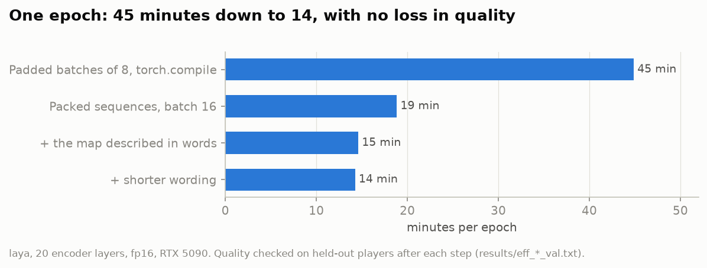

# Training speed

Every experiment here is a full fine-tuning run of a 421M model, and the learning-curve and data-mix questions need
many of them. Speed decided how many questions could be asked. Everything ran on one RTX 5090.

## Where the time goes

`finetune_fast.py` replaces laya's reference training script. Measured on the original recipe (batch of 8, fp16):

- a step costs about **26 ms of fixed overhead** (kernel launches, Python, the optimizer, gradient clipping) **plus
  0.02 ms per token**;
- in a random batch of 8 human-game questions, **47 % of the tokens are padding**: question lengths range from 214 to
  744 tokens between the 10th and the 90th percentile.

## What helped

**Cross-entropy instead of the RL objective.** laya's script trains with a reward term on noisy logits. Plain
cross-entropy is simpler and cheaper, and an independent analysis of laya's recipe
([Sev](https://github.com/LakoreAI/sev), 30 runs) found it no worse on accuracy, log loss or calibration. Adding a
ranked-probability term for the ordered questions cost 21 % more time here and changed nothing
(`results/eff_abc_val.txt`).

**`torch.compile`.** 13.7 → 16.9 steps a second (×1.23) on fixed-length buckets. CUDA graphs on top added nothing.
The default recompilation limit (8) is lower than the number of length buckets, which silently sends the extra shapes
back to eager mode; it is raised to 64.

**20 layers instead of 28.** No loss on the risk model, ×1.35 ([risk](risk.md)).

**Packed sequences** (`packed.py`, `finetune_fast.py --pack`). Instead of padding each question to the batch's
longest, the questions of a batch are concatenated into one row and attention is computed per segment with
`torch.nn.attention.varlen.varlen_attn` (PyTorch 2.14), including ModernBERT's 128-token sliding window in the local
layers. The encoder is compiled with dynamic shapes; laya's small head runs on the unpacked positions as before.
Checked against the padded model on the same inputs: logits within 0.008, gradients with cosine similarity ≥ 0.9988.
At a batch of 8 it doubled the steps per second (×1.97); with a batch of 16 a full epoch took 1131 s instead of 2693 s
(×2.38), and the model was no worse (slightly better on one question; `results/eff_aa16_val.txt`).

**Fewer tokens per state.** The map described in words and shorter wording ([what the model is asked](questions.md))
took the epoch from 1131 to 856 s with no loss.

**A tokenisation cache.** Tokenising a dataset took 102 to 149 s of idle GPU at the start of every run. Tokenised
examples are now cached per line (keyed by the line's hash, the length limits, the tokenizer and the source of the
code that builds examples): 109 s → 3.3 s for a full training set, and subsets reuse the full set's cache.

## What did not

- **Several questions per pass** (all questions about one state in one sequence, each with its own markers). 1.8×
  more steps a second at the same tokens per second, and on equal compute (two epochs) as good as one question per
  pass. After packing, one question per pass was faster still, so it was not adopted.
- **FP8 and NVFP4.** On this card and these matrix shapes FP8 matmuls are 0.89 to 1.08× of bf16; NVFP4 is slower than
  bf16. Not worth the precision.
- **bf16** gives batch-dependent answers in rare cases ([risk](risk.md)); fp16 is as fast and closer to fp32.
- **Other frameworks.** For ModernBERT, Unsloth amounts to `torch.compile` plus SDPA without gradient checkpointing,
  which is what is used here. JAX would mean porting the model; Rust or C++ would only remove Python overhead, which
  CUDA graphs already showed to be small.
- **Optimiser and data-selection tricks** (Muon, SOAP, schedule-free optimisers, loss-based sample selection, token
  dropping, LoRA) were looked at in the literature and not tried: they are either for pretraining, worse for full
  fine-tuning of an AdamW-trained model, or worse on noisy labels.
- **The smaller GPU.** An RTX 3060 Ti (8 GB) cannot hold the model with optimizer state for training and would slow a
  shared run down to its speed. It is used for inference and the screensaver.
